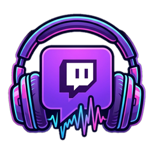
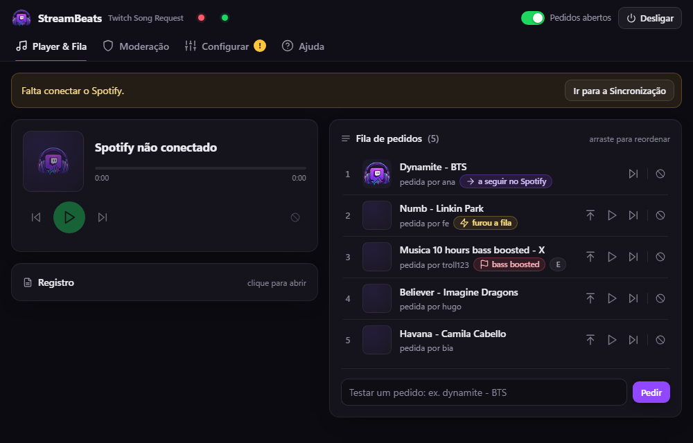
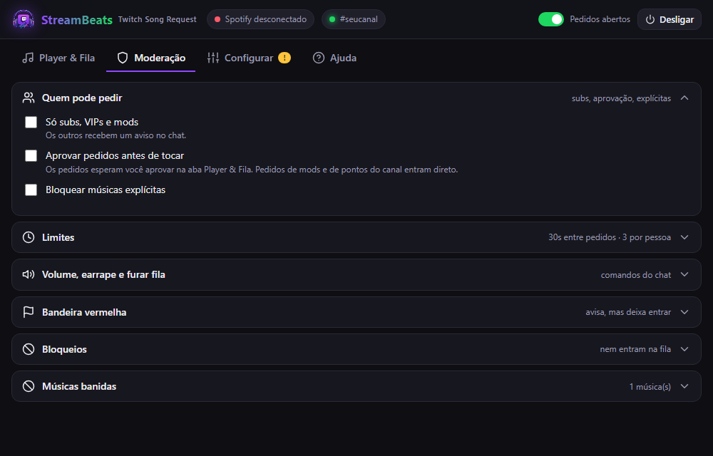

<div align="center">



# StreamBeats · Twitch Song Request

**Pedidos de música do chat da Twitch direto no Spotify. Grátis, sem limite e rodando no seu PC.**

*Free, unlimited Twitch → Spotify song requests that run on your own PC (Windows, Portuguese UI).*

[](../../releases/latest)


</div>

---

O chat digita `!sr dynamite - BTS` e a música entra na fila. O StreamBeats é uma alternativa aberta aos apps pagos de song request: tudo roda localmente, ele não cobra nada, não tem limite de pedidos e só conversa com a Twitch e com o Spotify.

<p align="center"></p>

## ✨ Recursos

**Fila de verdade**
- Arraste pra reordenar, mande pro topo, toque na hora ou tire um pedido da fila.
- O app guarda a fila e manda **uma música por vez** pro Spotify, uns segundos antes da atual acabar. Isso contorna a fila do Spotify, que não deixa apps mexerem nela.
- Aprovação manual de pedidos (opcional).
- A fila fica salva em disco e sobrevive se o app ou o PC reiniciar.

**Moderação**
- 🚩 **Bandeira vermelha:** a música entra, mas fica marcada com o motivo. É bom pra "gemidão", "earrape", "10 hours"...
- Botão de **banir** separado do de **pular**, e lista de músicas banidas com opção de desbanir.
- Bloqueio de termos e de usuários.
- Limite por pessoa, com mais pedidos pra subs e VIPs.
- Tempo de espera, tamanho máximo da fila, duração máxima e bloqueio de músicas explícitas.
- `!voteskip`: o chat vota pra pular.

**Busca esperta**
- Tolera erro de digitação: "bohemian rapsody quen" encontra a música certa.
- Recusa texto sem sentido, emoji solto e link de playlist, álbum ou YouTube.
- Aceita link de música do Spotify, inclusive os links curtos `spotify.link`.

**Interação com o chat**
- Volume pelo chat (`!volume 50`, `!vol+`, `!vol-`), com quem pode usar e um volume máximo.
- `!furarfila` e `!earrape` (volume no máximo por alguns segundos, depois volta sozinho), cada um com permissão e tempo de espera.
- **Pontos do canal:** o app cria as recompensas na Twitch (Pedir música, Furar fila, Earrape), liga e desliga cada uma e **devolve os pontos sozinho** quando um pedido falha.

**Pra live**
- Overlay pro OBS (Fonte de Navegador), com capa, nome, barra de tempo, "pedida por" e as próximas da fila. O fundo é transparente, e ele some sozinho quando você pausa a música.
- **Stream Deck** (Fifine, Elgato e outros): um atalho pra cada comando (tocar/pausar, pular, volume, earrape e mais). É só arrastar pro botão.
- Dois cartões no canto do painel mostram se a live está no ar e se o Spotify está tocando. Clique num deles pra reconectar.
- Histórico das 3 últimas lives, com botão pra criar uma playlist no Spotify com as músicas da live que você escolher.
- Painel numa janela própria (sem a janela preta), que reconecta sozinho.
- Atualização automática pelos Releases do GitHub, com conferência de assinatura SHA-256.

<p align="center"></p>

## 🚀 Começando

> **Precisa:** Windows 10/11 e **Spotify Premium**. A segunda é uma regra do Spotify: só conta Premium pode adicionar músicas na fila por um app.

1. Baixe o **`StreamBeats-TwitchSongRequest.exe`** em [**Releases**](../../releases/latest) e coloque numa pasta própria.
2. Abra. Na primeira vez, o Windows pode avisar "O Windows protegeu o computador", porque o app não tem assinatura digital paga. Clique em **Mais informações → Executar assim mesmo**.
3. O painel abre na aba **Configuração**, no quadro **Sincronização**:
   1. **Spotify** (obrigatório): crie um app grátis em [developer.spotify.com](https://developer.spotify.com/dashboard). O painel mostra o passo a passo e o endereço exato pra colar.
   2. **Canal da Twitch** (obrigatório): o nome do seu canal.
   3. **Entrar na Twitch** (recomendado): faz o bot responder no chat e libera os pontos do canal.
   4. **Pontos do canal** (opcional): recompensas pra pedir música, furar a fila e earrape.
4. Dê play numa playlist no Spotify. Quando os pedidos acabam, ele volta pra ela.

O manual completo, com todos os comandos e opções, está em [**LEIA-ME.md**](LEIA-ME.md).

## 💬 Comandos

| Comando | Quem pode | O que faz |
|---|---|---|
| `!sr música - artista` | todos | pede uma música (aceita link do Spotify) |
| `!song` | todos | música atual, quem pediu e link |
| `!fila` | todos | próximas 3 e a posição do seu pedido |
| `!wrongsong` / `!errada` | todos | tira o seu último pedido |
| `!voteskip` | todos | vota pra pular |
| `!volume` · `!vol+` · `!vol-` | mods* | volume |
| `!furarfila música` | mods* | pede na frente da fila |
| `!earrape` | mods* | volume no máximo por alguns segundos |
| `!skip` · `!sron` · `!sroff` | mods | pula · abre · fecha os pedidos |

\* dá pra liberar pra VIPs, subs ou todos. Os nomes dos comandos são editáveis. "Mods" inclui o Moderador Líder e o dono do canal.

## 🔒 Privacidade e segurança

- Tudo roda no seu PC. O app só fala com `api.spotify.com`, com a Twitch e com o GitHub deste projeto (para procurar atualizações).
- O login do Spotify usa **PKCE**, sem "client secret". O Client ID não é senha.
- O painel só aceita acessos do próprio PC e usa uma chave por sessão, então outros sites não conseguem controlar o app.
- Os logins ficam em `tokens.json`, do lado do app. Não compartilhe esse arquivo.

## 🛠️ Para desenvolvedores

Não tem dependências: o app é um único `streambeats.js` em Node.js puro, mais o `painel.html` e o `overlay.html`.

```powershell
# rodar a partir do código (Node.js 22 ou mais novo)
node streambeats.js            # ou: iniciar-com-janela.bat

# gerar o .exe (baixa o Node.js oficial, confere o SHA-256, embute ícone e versão)
.\gerar-exe.bat

# publicar uma versão nova (precisa do GitHub CLI logado)
.\publicar-versao.ps1 -Versao 1.0.1 -Notas "o que mudou"
```

O `.exe` é gerado com o recurso [Single Executable Applications](https://nodejs.org/api/single-executable-applications.html) do próprio Node.js. O ícone, as informações de versão e o modo sem janela são aplicados por scripts em `ferramentas/`, que usam só APIs do Windows. Não tem nenhuma ferramenta de terceiros.

## 📄 Licença

[MIT](LICENSE). Os ícones são baseados no [Lucide](https://lucide.dev) (ISC): veja [LICENCAS-DE-TERCEIROS.md](LICENCAS-DE-TERCEIROS.md).

O StreamBeats não é afiliado à Twitch nem ao Spotify. Tocar música com direitos autorais na live pode gerar avisos de DMCA: mantenha o áudio do Spotify numa faixa do OBS que não vai pro VOD.
